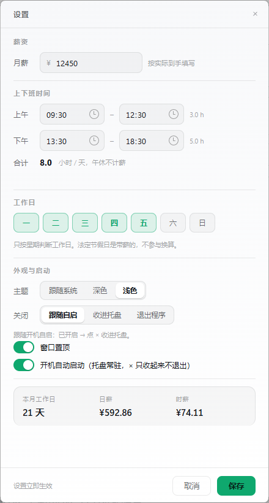
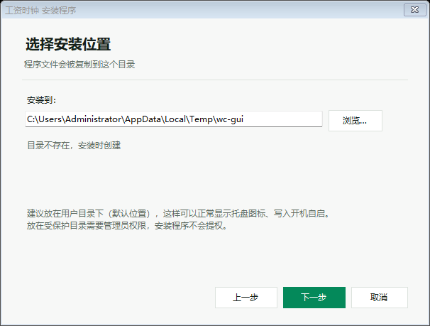
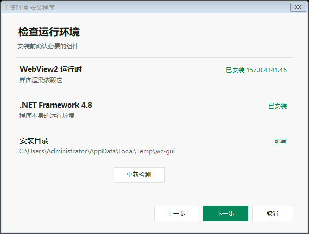

# 工资时钟 · Wage Clock

把上班时间换算成钱的 Windows 桌面小挂件：实时滚动「窝囊费已赚」，倒数距离下班还有多久，进度条是一根从左往右烧掉的仙女棒。


---

## 界面

| 位置 | 含义 |
| --- | --- |
| 左上 | 日期 + 状态徽标（待开工 / 工作中 / 午休 / 已下班 / 今日休息） |
| 中间 | **窝囊费已赚**：4 位整数 + 4 位小数，按秒滚动；颜色按今日完成度从红渐变到绿 |
| 进度条 | 已过的时间烧成灰，未过的仍是引线，交界处是喷火星的火头 |
| 底栏左 | 距周末：到本周最后一个班次结束 |
| 底栏中 | 距下班：数字钟到百分秒 `07:18:00.00` |
| 底栏右 | 本月：已出勤 / 应出勤 |
| 右上 | 置顶、设置、隐藏（×） |

## 功能

- **时间驱动**：不开历史账单，每一帧都从系统时间重算，改系统时间、跨零点、休眠唤醒都不会算错或累加。
- **两段班次**：上午 + 下午，中间午休不计薪，金额与进度条一起冻结。
- **法定节假日**：内置 2026 年国务院放假与调休补班表，补班的周末照常计薪。
- **仙女棒进度条**：火头每秒喷射约 95 颗带拖尾的火星，受重力下坠；进度条画的是「还剩多少引线」。
- **深 / 浅 / 跟随系统**：点一下立即生效，不用保存；点取消会还原。
- **托盘常驻**：关闭行为可选「跟随自启 / 收进托盘 / 退出程序」，托盘图标左键切换显示，右键菜单退出。
- **开机自启**：写注册表 Run 项，启动时直接进托盘。

## 设置页



月薪、上下班时间、工作日、节假日开关、主题、关闭行为、窗口置顶、开机自启。底部实时显示本月工作日、日薪、时薪。

## 计算口径

```
日薪 = 月薪 ÷ 当月应出勤工作日           （含法定节假日与调休补班）
时薪 = 日薪 ÷ 每日工时                   （两段班次时长之和，午休不计）
已赚 = 日薪 × 已工作秒数 ÷ 应工作秒数     （向下取整到 4 位小数）
进度 = 已工作秒数 ÷ 应工作秒数           （0…1，线性，用于金额颜色）
```

工资表按月统计，月份变了工作日数跟着变；节假日只影响「某天算不算工作日」，不影响当月总数逻辑。

## 状态机

| 状态 | 触发 | 金额 | 进度条 |
| --- | --- | --- | --- |
| 待开工 | 工作日、早于上午上班 | 0，只倒计时 | 整根完好，无火头 |
| 工作中 | 任一班次时段内 | 线性增长 | 灰烬增长，火头随之前移 |
| 午休 | 两段班次之间 | 冻结 | 火头定格，火星停喷 |
| 已下班 | 晚于下午下班 | 等于日薪，不再增长 | 整条烧成灰，火头熄灭 |
| 今日休息 | 周末或法定假日 | 0 | 进度条隐藏 |

各状态实拍：


## 运行

已安装副本：`C:\Users\Administrator\Apps\WageClock\WageClock.exe`，双击即可。

| 操作 | 效果 |
| --- | --- |
| 拖动卡片空白处 | 移动窗口，位置自动记住 |
| `Ctrl` + `Alt` + `W` | 全局快捷键，显示 / 隐藏 |
| 右键卡片 | 菜单：设置 / 隐藏窗口 / 窗口置顶 / 退出 |
| 左键托盘图标 | 显示 / 隐藏 |
| 右键托盘图标 | 菜单：显示隐藏 / 设置 / 退出 |
| `×` | 按「关闭行为」设置执行：跟随自启 / 收进托盘 / 退出程序 |

设置与窗口位置保存在 `%APPDATA%\WageClock\settings.json`。

## 安装包

`WageClockSetup.exe` 是一个向导式安装程序：选目录、查依赖、装完即可用，卸载走「设置 → 应用」。

| 步骤 | 内容 |
| --- | --- |
| 欢迎 | 版本号与功能简介，说明为当前用户安装、不需要管理员权限 |
| 安装位置 | 默认 `%LOCALAPPDATA%\Programs\WageClock`，可浏览选择；实时提示目录是否存在、可否写入 |
| 环境检查 | WebView2 运行时、.NET Framework 4.8、目标目录可写；缺 WebView2 时可以一键静默安装（安装包内置微软引导程序，离线也能装） |
| 附加任务 | 桌面快捷方式 / 开始菜单 / 开机自启 / 装完启动 |
| 完成 | 显示程序位置与常用操作，可立即启动 |





卸载默认**保留**个人设置（月薪、班次、窗口位置），要连设置一起清掉就用 `/purge`。
安装包不弹 UAC：它只写当前用户的目录与 `HKCU`，装到 `Program Files` 这类受保护位置会提示换成可写目录。

命令行（批量部署或自动化测试用）：

```powershell
WageClockSetup.exe /silent /dir=D:\Apps\WageClock /nostart     # 静默安装
uninstall.exe /uninstall /silent                               # 静默卸载，保留设置
uninstall.exe /uninstall /silent /purge                        # 连设置一起删
```

## 项目结构

```
src/
  index.html            卡片页面
  settings.html         设置页
  lib/schedule.js       排班与薪资计算（纯函数，浏览器与 Node 共用）
  lib/holidays.json     2026 年法定节假日与调休补班
  scripts/widget.js     卡片渲染、滚动数字、仙女棒粒子、主题
  scripts/settings.js   设置页表单与实时预览
  scripts/bridge.js     页面与宿主的 IPC 封装
  styles/               两套界面的样式
host/
  WageClock.cs          WinForms + WebView2 宿主：窗口、托盘、热键、持久化
  Shot.cs               固定时刻截图工具（回归用）
  AssemblyInfo.cs       程序集信息
  app.manifest          DPI 感知声明
installer/
  Setup.cs              安装程序：向导、依赖检测、安装与卸载
  AssemblyInfo.cs       安装程序版本信息
tools/
  build.ps1             用 csc 编译宿主
  build-installer.ps1   打包程序文件并编译安装程序
  make-icon.ps1         生成多尺寸应用图标
  make-sheet.ps1        把各状态截图拼成总览图
  wv2/                  WebView2 SDK 程序集（构建依赖）
tests/schedule.test.js  计算核心的 10 个单测
shots/                  总览图与实机截图（各状态图由 --shot 生成，不入库）
design/                 第一轮需求线框
```

## 开发

**构建**（需要 .NET Framework 4.8 的 csc，Windows 10/11 自带）：

```powershell
.\tools\build.ps1                 # 输出 build\WageClock.exe
.\tools\build-installer.ps1       # 输出 build\WageClockSetup.exe（先自动编译主程序）
```

`build-installer.ps1` 会把 `build\` 里的程序和 `src`、`assets` 打成 `payload.zip` 嵌进安装程序，首次运行时会下载一次 WebView2 引导程序缓存在 `build\cache\`（约 1.8 MB）。

**测试**：

```powershell
node --test                       # 10 个用例，覆盖状态机、金额单调性、节假日、坏配置
```

**截图回归**：`WageClock.exe --shot DIR` 会用固定时刻渲染 11 张状态图（2 倍分辨率）。这些图是生成物、不入库；`tools\make-sheet.ps1` 发现缺图会自己调一次 `--shot`，再拼成 `shots\sheet.png`。命令行还有 `--tray`（启动即进托盘）、`--quit`（关闭已运行实例）。截图前要先退出正在运行的实例（单实例锁会挡住截图进程）。

**调试开关**：`WAGE_CLOCK_DEBUG=1` 输出 IPC 与托盘日志到 `wage-clock.log`；`WAGE_CLOCK_DATA=<目录>` 指定数据目录，便于用隔离配置做实验。

## 已知边界

- 仅 Windows 10 / 11，需要 **WebView2 Runtime**（Win11 自带，Win10 可能需要装）。
- 单实例运行：再次启动会唤回已有窗口，不会开第二个。
- 数据目录不可写时（例如放在受保护的目录）会退回到程序旁的 `data\`。
- **不要从低完整性级别的目录启动**（例如某些沙箱路径）：进程会被降权，`Shell_NotifyIcon` 返回拒绝，托盘图标不出现、开机自启也写不进去。装到用户目录下再运行。
- 节假日表目前只到 2026 年，跨年后需要更新 `src/lib/holidays.json`。
