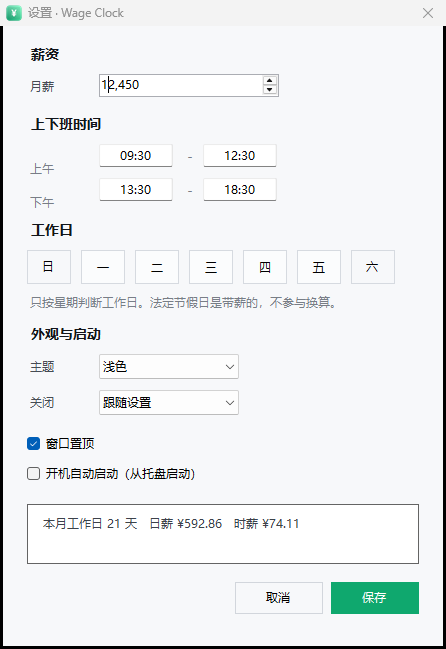
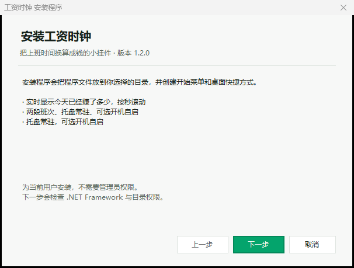

# 工资时钟 · Wage Clock

把上班时间换算成钱的 Windows 桌面小挂件：实时滚动「窝囊费已赚」，倒数距离下班还有多久，进度条是一根从左往右烧掉的仙女棒。


---

## 界面

| 位置 | 含义 |
| --- | --- |
| 左上 | 日期 |
| 右上 | 状态（待开工 / 工作中 / 午休 / 已下班 / 今日休息）与置顶、设置、隐藏三个按钮 |
| 中间 | **窝囊费已赚**：4 位整数 + 4 位小数，按秒滚动；整数比小数大 1.5 倍，共享基线，字号按宽度自适应（上限 120px） |
| 进度条 | 已过的时间烧成灰，未过的仍是引线，交界处是喷火星的火头 |
| 底栏左 | 距周末：到本周最后一个班次结束 |
| 底栏中 | 距下班：数字钟到百分秒 `07:18:00.00` |
| 底栏右 | 本月：已出勤 / 应出勤 |

## 功能

- **时间驱动**：不开历史账单，每一帧都从系统时间重算，改系统时间、跨零点、休眠唤醒都不会算错或累加。
- **两段班次**：上午 + 下午，中间午休不计薪，金额与进度条一起冻结。
- **仙女棒进度条**：火头持续喷射带辉光的火星，受重力下坠；进度条画的是「还剩多少引线」。
- **深 / 浅 / 跟随系统**：设置里切换后卡片与设置窗口一起换肤。
- **托盘常驻**：关闭行为可选「跟随设置 / 收进托盘 / 退出程序」，托盘图标左键切换显示，右键菜单退出。
- **开机自启**：写注册表 Run 项，启动时直接进托盘。
- **真透明**：卡片用分层窗口 + 逐像素 alpha 自绘，背景半透明、数字完全不透明。

## 设置页



月薪、上下班时间、工作日、主题、关闭行为、窗口置顶、开机自启。底部实时显示本月工作日、日薪、时薪。

## 计算口径

```
日薪 = 月薪 ÷ 当月应出勤工作日           （按你勾选的星期，只算周末）
时薪 = 日薪 ÷ 每日工时                   （两段班次时长之和，午休不计）
已赚 = 日薪 × 已工作秒数 ÷ 应工作秒数     （向下取整到 4 位小数）
进度 = 已工作秒数 ÷ 应工作秒数           （0…1，线性，用于金额颜色）
```

工资表按月统计，月份变了工作日数跟着变。法定节假日是带薪的，不影响日薪，因此不参与换算；需要的话可以在 `settings.json` 的 `overrides` 里给某天手动标记 `on` / `off`。

## 状态机

| 状态 | 触发 | 金额 | 进度条 |
| --- | --- | --- | --- |
| 待开工 | 工作日、早于上午上班 | 0，只倒计时 | 整根完好，无火头 |
| 工作中 | 任一班次时段内 | 线性增长 | 灰烬增长，火头随之前移 |
| 午休 | 两段班次之间 | 冻结 | 火头定格，火星停喷 |
| 已下班 | 晚于下午下班 | 等于日薪，不再增长 | 整条烧成灰，火头熄灭 |
| 今日休息 | 周末 | 0 | 进度条隐藏 |

## 运行

双击 `WageClock.exe` 即可，不需要安装 WebView2 或任何运行时（.NET Framework 4.8 是系统自带的）。

| 操作 | 效果 |
| --- | --- |
| 拖动卡片空白处 | 移动窗口，位置自动记住 |
| `Ctrl` + `Alt` + `W` | 全局快捷键，显示 / 隐藏 |
| 右键卡片 | 菜单：设置 / 隐藏窗口 / 窗口置顶 / 退出 |
| 左键托盘图标 | 显示 / 隐藏 |
| 右键托盘图标 | 菜单：显示隐藏 / 设置 / 退出 |
| `×` | 按「关闭行为」设置执行：跟随设置 / 收进托盘 / 退出程序 |

设置与窗口位置保存在 `%APPDATA%\WageClock\settings.json`。

## 安装包

`WageClockSetup.exe` 是一个向导式安装程序（约 227 KB）：选目录、查依赖、装完即可用，卸载走「设置 → 应用」。

| 步骤 | 内容 |
| --- | --- |
| 欢迎 | 版本号与功能简介，说明为当前用户安装、不需要管理员权限 |
| 安装位置 | 默认 `%LOCALAPPDATA%\Programs\WageClock`，可浏览选择；实时提示目录是否存在、可否写入 |
| 环境检查 | .NET Framework 4.8、目标目录可写 |
| 附加任务 | 桌面快捷方式 / 开始菜单 / 开机自启 / 装完启动 |
| 完成 | 显示程序位置与常用操作，可立即启动 |



卸载默认**保留**个人设置（月薪、班次、窗口位置），要连设置一起清掉就用 `/purge`。
安装前会结束所有正在运行的实例，避免旧进程被单实例锁留着、新版本启动后立刻退出。

命令行（批量部署或自动化测试用）：

```powershell
WageClockSetup.exe /silent /dir=D:\Apps\WageClock     # 静默安装
uninstall.exe /uninstall /silent                     # 静默卸载，保留设置
uninstall.exe /uninstall /silent /purge              # 连设置一起删
```

## 项目结构

```
host/
  WageClock.cs          宿主：窗口生命周期、托盘、热键、单实例、持久化、安装外的全部逻辑
  CardWindow.cs         卡片：分层窗口 + GDI+ 自绘（面板、滚动数字、进度条、火星、图标）
  NativeSettingsForm.cs 设置窗口：纯 WinForms 控件
  Schedule.cs           排班与薪资计算（纯函数）
  SelfTest.cs           计算核心的 53 条断言
  Theme.cs              深浅两套配色
installer/
  Setup.cs              安装程序：向导、环境检查、安装与卸载
  AssemblyInfo.cs       安装程序版本信息
tools/
  build.ps1             用 csc 编译主程序
  build-installer.ps1   打包程序文件并编译安装程序
  make-icon.ps1         生成多尺寸应用图标
  mock/Mock.cs          设计稿生成器（三套版面方案）
docs/
  card-design.md        卡片视觉设计稿
  composition-hosting-notes.md  合成托管的调研与排查笔记
  release-notes/        各版本发布说明
shots/                  实机截图
design/                 第一轮需求线框
```

## 开发

**构建**（需要 .NET Framework 4.8 的 csc，Windows 10/11 自带）：

```powershell
.\tools\build.ps1                 # 输出 build\WageClock.exe
.\tools\build-installer.ps1       # 输出 build\WageClockSetup.exe（先自动编译主程序）
```

**测试**：

```powershell
.\build\WageClock.exe --selftest  # 输出 selftest.txt，退出码 0 表示全部通过
```

**看不同时刻的界面**（不影响系统时间）：

```powershell
.\build\WageClock.exe --demo 2026-11-12T15:20:00
```

`--demo` 从指定时刻开始按真实节奏往前走，便于截取「工作中」「午休」等状态。
命令行还有 `--quit`（关闭已运行实例）。

**调试开关**：`WAGE_CLOCK_DEBUG=1` 输出托盘与设置日志到 `wage-clock.log`。

## 已知边界

- 仅 Windows 10 / 11，无额外运行时依赖。
- 单实例运行：再次启动会唤回已有窗口，不会开第二个。
- 数据目录不可写时（例如放在受保护的目录）会退回到程序旁的 `data\`。
- **不要从低完整性级别的目录启动**（例如某些沙箱路径）：进程会被降权，`Shell_NotifyIcon` 返回拒绝，托盘图标不出现、开机自启也写不进去。装到用户目录下再运行。
- 每次重新编译 exe，Windows 会把托盘图标当成新图标重新折叠进 `^`，需要再拖出来一次。
